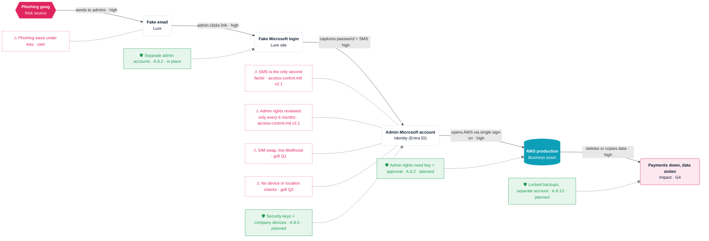

# R-002 · Phishing gang could make payments unavailable and steal customer data in AWS production through a fake Microsoft login that captures an IT admin's password and SMS code

**Owner** CTO · **Status** open · **Due** 2026-12-31 (controls 1–3 by 2026-11-30)

## Scenario
- **Risk source**: organised phishing gang, active against Acme Pay right now (current phishing wave).
- **Feared event**: payments unavailable (production deleted or encrypted) and customer data disclosed.
- **Asset**: AWS production, which runs the payment platform and holds customer data. IT admins reach it through Entra ID single sign-on.
- **Why it works**: SMS is the only second factor (access-control policy v2.1). A real-time phishing kit (adversary-in-the-middle, e.g. Evilginx-type) relays the password and the SMS code within seconds and steals the session cookie. PIM activation also prompts for SMS, so it is phished the same way. SIM swap is a secondary route to the same SMS code, rated low likelihood.
- **Business value**: core revenue service; outage or breach triggers DORA major ICT incident reporting (Art. 19), NIS2 notification (Art. 23) and GDPR breach notification (Art. 33–34).

## Attack path
Visual: `R-002-attack-path.html`



## Score
| | Severity | Likelihood | Level |
|---|---|---|---|
| Inherent | G4 critical | V3 likely | **high** (above appetite) |
| Residual | G4 critical | V1 unlikely | **medium** (within appetite) |

```
        V1    V2    V3    V4
G4      ○  ←  ←  ←  ●
G3
G2
G1
```
Severity stays G4: the worst case is unchanged. The controls cut the likelihood by removing the phishable factor.

## Treatment
**Reduce.** The inherent level is high and the appetite caps residual risk at medium. Phishing-resistant MFA removes the root cause at low cost, and DORA Art. 9(4)(d) and NIS2 Art. 21(2)(j) expect strong authentication on privileged access.

| # | Control | Due | ISO 27001 | NIS2 | DORA | GDPR |
|---|---|---|---|---|---|---|
| 1 | Phishing-resistant MFA for admins (FIDO2 keys / passkeys via Entra authentication strength); SMS removed | 2026-11-30 | A.8.5, A.5.17 | Art. 21(2)(j) | Art. 9(4)(d) | Art. 32(1)(b) |
| 2 | Conditional Access: admin sign-in only from compliant company devices | 2026-11-30 | A.8.5, A.8.1 | Art. 21(2)(i), (j) | Art. 9(4)(c) | Art. 32(1)(b) |
| 3 | PIM activation requires the key and a second-person approval | 2026-11-30 | A.8.2 | Art. 21(2)(i) | Art. 9(4)(c) | Art. 32(1)(b) |
| 4 | Backups in a separate AWS account with Backup Vault Lock (immutable) | 2026-12-31 | A.8.13 | Art. 21(2)(c) | Art. 12 | Art. 32(1)(c) |
| 5 | Entra risky sign-in alerts routed to whoever watches security alerts | 2026-12-31 | A.8.16 | Art. 21(2)(b) | Art. 10 | Art. 33 |

Already in place: separate admin accounts (A.8.2), PIM (A.8.2). Follow-up: update access-control policy v2.1 so SMS is no longer allowed for privileged accounts (A.5.15).

## Decisions
Trace: `../traces/2026-10-30-r-002-admin-sms-mfa-phishing.md`

Calls made without the user:
- Residual score G4·V1 medium.
- Risky sign-in detection treated as absent (user didn't know; unproven controls are not scored).
- Control placement on the drawn path; risky sign-in alerts not drawn, listed in the table only.
