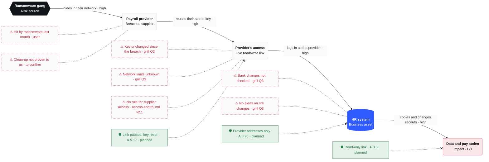

# R-003 · Ransomware gang already inside the payroll provider could steal or change staff personal and bank data in the HR system through the provider's live read/write link

**Owner** HR Director · **Status** open · **Due** 2026-12-31 (control 1 by 2026-11-02, controls 2–5 by 2026-11-20)

## Scenario
- **Risk source**: the ransomware gang that hit our payroll provider last month. We have no proof it has been removed from the provider's systems.
- **Feared event**: staff personal and bank data stolen (disclosure), and bank details changed so a payroll run goes to the gang's accounts (alteration). Secondary route: a fake employee written into the HR system gets a real Microsoft 365 login, and through single sign-on, AWS. Hire approval before account creation blocks most of this route.
- **Asset**: the HR system. It holds ~200 staff records (identity, address, bank details) and is the source for automatic account creation.
- **Why it works**: the provider's automated link can write, bank details included. Its key has not been reset since the breach, and its network restriction is unknown. Nobody checks bank-detail changes and no alert fires on unusual changes. Access-control policy v2.1 has no rule on supplier access.
- **Business value**: staff trust and payroll continuity. A leak triggers GDPR breach notification within 72 hours (Art. 33–34). A supplier-borne incident falls under DORA Art. 28 third-party risk and NIS2 Art. 21(2)(d) supply chain security.

## Attack path
Visual: `R-003-attack-path.html`



## Score
| | Severity | Likelihood | Level |
|---|---|---|---|
| Inherent | G3 serious | V3 likely | **high** (above appetite) |
| Residual | G3 serious | V1 unlikely | **medium** (within appetite) |

```
        V1    V2    V3    V4
G4
G3      ○  ←  ←  ←  ●
G2
G1
```
Severity stays G3 because a leak, once it happens, is as bad as before. The controls cut the likelihood: they close the gang's way in and take away its ability to write.

## Treatment
**Reduce.** The inherent level is high and the appetite caps residual risk at medium. The first control costs nothing and closes the link today.

| # | Control | Due | ISO 27001 | NIS2 | DORA | GDPR |
|---|---|---|---|---|---|---|
| 1 | Pause the link until the provider shows its forensic report, then reset its key | 2026-11-02 | A.5.21, A.5.17 | Art. 21(2)(d) | Art. 28(1), 28(7) | Art. 28(3)(c), 32 |
| 2 | Allow the link only from the provider's known network addresses | 2026-11-20 | A.8.20 | Art. 21(2)(d), (i) | Art. 9(4)(c) | Art. 32(1)(b) |
| 3 | Make the link read-only: no bank-detail or new-hire writes | 2026-11-20 | A.8.3 | Art. 21(2)(i) | Art. 9(4)(c) | Art. 25(2), 32 |
| 4 | Call the employee back before any bank change takes effect | 2026-11-20 | A.5.3 | Art. 21(2)(a) | Art. 9(2) | Art. 32(1)(b) |
| 5 | Alert on bulk edits, bank changes and new hires made through the link | 2026-11-20 | A.8.16 | Art. 21(2)(b) | Art. 10 | Art. 33 |
| 6 | Add a supplier-access rule to the access-control policy: periodic review, reset after any supplier incident, breach-notice clause in contracts | 2026-12-31 | A.5.19, A.5.20, A.5.22 | Art. 21(2)(d), 21(3) | Art. 28, 30 | Art. 28(3) |

Already in place: manager or HR approval before a new hire's account is created (A.5.16, A.5.18). It blocks the fake-hire route to Microsoft 365 and AWS.

## Decisions
Trace: `../traces/2026-10-30-r-003-payroll-provider-hr-link.md`

Calls made without the user:
- Residual score G3·V1 medium.
- Network restriction treated as absent (user didn't know; unproven controls are not scored).
- Fake-hire route kept in the scenario, not drawn as a separate branch: the path is linear and hire approval already blocks it.
- Control placement on the drawn path. The call-back (4) and alerts (5) are listed in the table only.
- DORA and NIS2 article references for the controls: Art. 28(7) and Art. 30 citations to confirm against the final texts.
