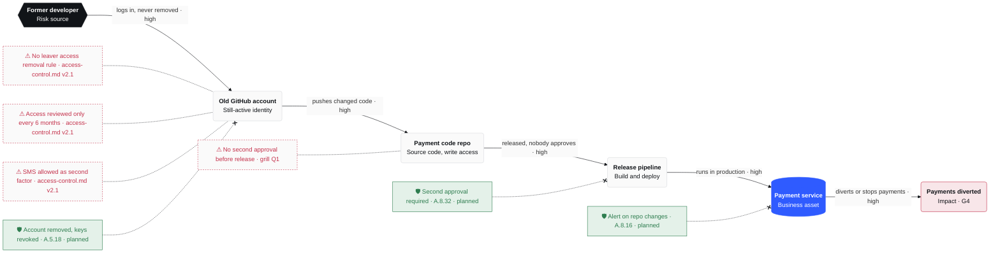

# R-004 · Former developer could alter the payment service through their still-active GitHub account's write access to the payment code repository

**Owner** CTO · **Status** open · **Due** 2026-11-30 (control 1 on 2026-10-30, controls 3 and 6 by 2026-11-13)

## Executive summary
- **What could happen**: someone using a former developer's still-active GitHub account changes the payment code. It reaches production with no second approval and quietly diverts or stops payments. Critical: lost money, a reportable incident, licence and customer trust at stake.
- **Why now**: the account was found still active with write access. No rule removes access when people leave, and nothing requires a second approval.
- **Where we stand**: high (G4·V3) today, above appetite → medium (G4·V1) after fixes, within appetite.
- **What we need**: the CTO removes the account today, then ships 6 fixes by 2026-11-30. Mostly settings changes; security key cost not yet estimated.

## Scenario
- **Risk source**: the former developer, or anyone who takes over their account (stolen password, SMS code, old token or SSH key).
- **Feared event**: the payment service is altered: payments diverted to an attacker's account, or stopped.
- **Asset**: the payment service and its code repository.
- **Why it works**: the account was never removed (access-control policy v2.1 has no leaver rule, and reviews run every 6 months). SMS is allowed as a second factor. A push to the payment repo reaches production with no second approval (grill Q1).
- **Business value**: the payment service moves customer money and holds customer payment data. A diverting change is a major ICT incident under DORA Art. 19, a significant incident under NIS2 Art. 23, and a personal data breach under GDPR Art. 33 when customer data is touched.

## Attack path
Visual: `R-004-attack-path.html`



## Score
| | Severity | Likelihood | Level |
|---|---|---|---|
| Inherent | G4 critical | V3 likely | **high** (above appetite) |
| Residual | G4 critical | V1 unlikely | **medium** (within appetite) |

```
        V1    V2    V3    V4
G4      ○  ←  ←  ←  ●
G3
G2
G1
```
Severity stays G4: if the code is changed, the damage is the same. The controls cut the likelihood: the account goes, and no single push reaches production.

## Treatment
**Reduce.** The inherent level is high and the appetite caps residual risk at medium. Control 1 costs nothing and closes the way in today.

| # | Control | Due | ISO 27001 | NIS2 | DORA | GDPR |
|---|---|---|---|---|---|---|
| 1 | Remove the account, revoke its tokens, SSH and deploy keys, audit its pushes since departure | 2026-10-30 | A.5.18, A.8.15 | Art. 21(2)(i) | Art. 9(4)(c) | Art. 32(1)(b) |
| 2 | Leaver process: an HR departure removes GitHub access the same day, through SSO | 2026-11-30 | A.5.16, A.6.5 | Art. 21(2)(i) | Art. 9(4)(c) | Art. 32(1)(b) |
| 3 | Payment repo: second approval required, no bypass, owners named per folder | 2026-11-13 | A.8.4, A.8.32 | Art. 21(2)(e) | Art. 9(4)(e) | Art. 25(1), 32 |
| 4 | Security key or authenticator app for GitHub, no SMS | 2026-11-30 | A.8.5 | Art. 21(2)(j) | Art. 9(4)(d) | Art. 32(1)(b) |
| 5 | Code-access review every quarter (today: every 6 months) | 2026-11-30 | A.5.18 | Art. 21(2)(i) | Art. 9(4)(c) | Art. 32(1)(d) |
| 6 | Alert on pushes and setting changes to the payment repo | 2026-11-13 | A.8.15, A.8.16 | Art. 21(2)(b) | Art. 10 | Art. 33 |

Already in place: MFA for all staff (SMS allowed) and a 6-monthly privileged-account review (access-control policy v2.1). Neither stopped this account.

## Decisions
Trace: `../traces/2026-10-30-r-004-former-dev-github-write.md`

Calls made without the user:
- Residual score G4·V1 medium.
- All 6 controls kept: the user chose reduce without dropping any.
- Scenario and path kept as drawn; the user corrected nothing.
- Asset value: moves customer money, holds customer payment data.
- Control placement on the drawn path: removal (1), second approval (3) and alerts (6). Leaver process (2), security key (4) and quarterly review (5) are in the table only; the key stops a thief at login, not the ex-developer's own valid keys.
- DORA Art. 9(4)(d) and 9(4)(e) citations to confirm against the final text.
