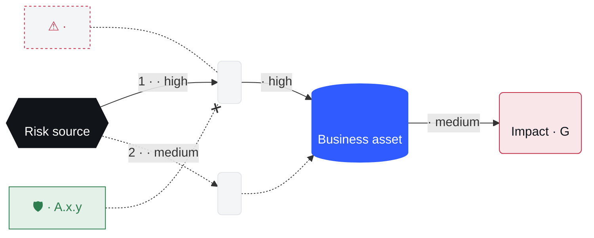

Turn a worry ("what if our payroll supplier gets ransomware?") into one scored, owned, treated risk in `grc/risk-register.md`. The risk is a **scenario** with up to 3 drawn **routes** (ways in, EBIOS RM operational scenarios), scored twice: **inherent** (today's controls) and **residual** (after treatment). The user decides through `grc-grill`; you look up the rest.

## Steps

1. **Frame.** Write the risk as one **scenario**: `<risk source> could <feared event: disclosed, altered, lost, unavailable> <asset>`. The ways in are its **routes**. Then look for the same risk, **by meaning, not wording**: same asset and same risk source or entry point count as the same risk, however it is phrased ("ex-dev still has GitHub write access" = "former developer can change payment code").
   - An `in progress` trace in `grc/traces/` for it: this run **resumes** it. Say so in one line (`Resuming R-004: 3 of 10 answers kept`) and hand the trace to grc-grill.
   - A row in `grc/risk-register.md` for it: this run is a **reassessment** of that row, same id.
   - When you are not sure it is the same risk, ask once, as the first question: resume or reassess `<id>`, or start a new risk.
   - Else it is new. Then show a **draft attack path** (see Draw: the most likely route, plus up to 2 other ways in the docs point to, with the weaknesses they show, no controls yet), titled `Draft`, before any question, so the user corrects the routes themselves. Done when the user has seen the scenario and its attack path, and you know whether it's new.

2. **Grill.** Call the Skill tool with `grc-grill`:
   - intensity: `hard`
   - destination: scenario, its routes (1 to 3, each with its entry point, steps and likelihood), asset and its business value, existing controls, severity, treatment (reduce, accept, transfer, avoid), risk owner, due date
   - docs: `grc/context.md`, `grc/risk-register.md`, `grc/policies/`, the latest audit in `grc/evidence/`
   - framework: the frameworks in scope; scoring by ISO 27005 and EBIOS RM
   - output default: `html`

   **Ask for other ways in once**, right after the first route is settled: "Any other way in?", with up to 2 routes you suggest from the docs (a phone call to the helpdesk, a supplier's access, a former employee's account) for the user to tick, plus `none`. One route is fine when the user says so; never invent one to fill the drawing.

   **The path follows the answers.** After each answer that changes the path (a new, removed or merged route, a new or removed step, a different entry point, an existing control, a weakness confirmed or ruled out, a new likelihood or severity), redraw it before the next question, in the same place, with one line saying what changed (`Added: SIM swap as a second route`). Answers that don't touch the path don't trigger a redraw. Never carry on with a path the user has corrected.

   Done when it hands back every field and the formats.

3. **Score.** Use the scales in `grc/context.md`, else these:
   - **Severity** G1 minor · G2 significant (recoverable) · G3 serious (hard to recover) · G4 critical (irreversible, or threatens the organisation).
   - **Likelihood** V1 unlikely · V2 possible · V3 likely · V4 near certain.

   **Talk in words, not codes.** G is severity (French *gravité*), V is likelihood (*vraisemblance*), from EBIOS RM; most users don't know that. In questions and replies say the word first, code after: "Critical (G4)", "Likely (V3)", "High risk (G4·V3)". When you ask for severity or likelihood, show the 4 options as a short list with one plain example each for this risk, so the user picks a word, not a code. Codes alone are fine only in tables and the register.
   - **Level** high when G3+ with V3+, or G4 with V2+; low when both are 2 or less; medium otherwise.

   **One severity, a likelihood per route.** Severity belongs to the feared event, so every route shares it. Each route gets its own likelihood, today and after the fixes. The risk is as likely as its **easiest route** (the EBIOS RM rule for a strategic scenario and its operational scenarios): inherent likelihood = the highest route today, residual = the highest route after the fixes. Say it in plain words when the fixes leave another route open ("The login fix closes route 1, but the helpdesk call stays Possible, so the risk only drops to medium"), and name the **next best fix**: the one control that would lower the route that now sets the residual.

   Score inherent, then residual with the treatment's controls in place. When residual is above the appetite in `grc/context.md` and the treatment is `accept`, the owner's acceptance must be in the trace as a `user` row, else ask for it. Done when both scores are set and the residual is within appetite or accepted.

4. **Map.** Look clauses up in [frameworks/](frameworks/), never from memory. For each control in the treatment, give its ISO 27001 ref from `iso27001.md`, then for each framework in scope in `grc/context.md` (ISO 27001 alone when none), the clauses of `<id>.md` whose ISO 27001 column holds that ref. A framework in scope with no file: its clause from memory, marked "clause to confirm". Then list the **extras** of those files the feared event would trigger (a breach to notify within 72 hours, a contract clause), as their own lines under the treatment. Done when every control has its ISO 27001 ref, every in-scope framework a column, and every triggered extra a line.

5. **Draw.** Decide the **attack path**, then draw it. Write every word for a manager, not an engineer: **plain words** ("fake login page", not "AiTM kit"; "admin's work account", not "Entra ID identity"); product names and jargon stay in the report.
   - **source**, **asset**, **impact**: shared by every route. The risk source, the business asset, the feared event with its severity (`type: Impact · G4`), and on `impact` the `edge` from asset to impact. Each node has an `icon` (`attacker user mail phone key web computer server cloud database container vendor payment lock bug alert`), a 1 to 3 word `label` and a `type`. With several routes, each of the three also gets a `profile`: one plain line under its zone header, from `grc/context.md` or the grill, never invented (source: who they are and what they want; asset: what it is worth to the business; impact: what it would cost, in money or days when known).
   - **routes**, 1 to 3, most likely first (a tie: fewer steps first): a `name` of 2 to 4 plain words (`Fake login page`), its `likelihood` (`today`, `after`, as V1 to V4), its **steps**, 1 to 3 hops the attacker takes (a lure, an identity, a credential, a system; keep each route to 2 when you can, as the side-by-side drawing fits 2 per route and falls back to tabs beyond), and its **edges**, one more than the steps: source to first step, step to step, last step to asset. When routes end on the same step (the finance laptop every lure leads to), give it the same `label` and `icon` in each: it is drawn once, where the routes join. More than 3 ways in: draw the 3 most likely and list the rest in the report.
   - **edges**: what the attacker does, in 2 to 4 words (`captures password + SMS`), its `severity`, and the `control` that breaks it when there is one (`name`, ISO 27001 `ref`, `status`: `in place` or `planned`). A control goes on the one hop it actually stops: separate admin accounts do not stop a click on a link. A control that stops no hop stays in the treatment table only.
   - **findings**: each weakness that makes a hop possible, in the `findings` of its step (`kind`: Weak spot, Missing control, Known flaw, Incident; `source`: the doc or audit that shows it). At most 3 per step, titles of 6 words or fewer; merge the rest. Context such as an ongoing phishing wave goes in the scenario, not on a node.
   - The header: id, title, scenario, inherent and residual score once scored, and `nextFix` (one plain sentence) when more than one route.
   - **Footholds**, so risks can chain: each route's `needs` (what the attacker must already hold to start it: `outside` for most) and the risk's `gives` (what the attacker holds once the asset is reached, or none when the feared event leaves nothing to use). Ids from `footholds.md` in the `attack-chain` skill's folder only; read it there.

   **Look** ([theme.md](theme.md)): soft gray background, flat and square, a small circle with a play ▶ icon (no text) where the path starts, then the nodes left to right in rows, each tile carrying its icon (never an empty box), each joined to the next by a thin black arrow labelled with what the attacker does; the risk source black, the asset electric blue, the impact and each weak spot dashed red, the hops gray; each control a green box on the hop it breaks (solid in place, dashed planned), with its ISO 27001 reference. **Several routes** sit in four zones, each with a colored top rule and its `profile`: Who attacks (black), How · n ways in (gray), What we protect (blue), What it costs us (red). The routes fan out from the risk source into one lane each and join again at the steps they all end with (drawn once, their weak spots listed once), else at the asset. One route is in focus at a time, route 1 first (`Showing route 1 of 3`): it shows its weak spots and the full names of its protections; the others are lighter (gray wires, smaller tiles) with a count badge and the control's reference only. Clicking a lane or a route in the rail switches the focus. Each lane is tagged with its rank and likelihood word (`1 · LIKELY`); arrows carry no severity tag, as the rail gives the likelihood. In a rail on the left of the drawing, read first and kept in view while scrolling: the verdict (`Likely today, unlikely after fixes.`), one bar per route (today → after fixes, never below V1, `—` when no fix is planned), the risk's bar (the easiest route), the next best fix and the legend. On narrow screens the rail moves above the drawing; too narrow for the fan: one route at a time behind tabs. Labels never cover a node, a weak spot or another label.

   Show it in the conversation first:
   1. **visualize.** Search your tools, deferred ones included, for `visualize` (or a widget, Artifact or canvas tool). When one exists, load it, read its read-me, and draw the attack path with it inline, in the look above and [theme.md](theme.md), not the tool's default palette. This is the default whenever such a tool exists.
   2. No such tool, on a local machine: open the saved copy in the default browser (`open` on macOS, `xdg-open` on Linux, `start` on Windows) and say so in one line with the path.
   3. No such tool, on a remote shell with a headless browser: screenshot the saved copy to `grc/risks/<id>-attack-path.png` and link it.
   4. None of these: print the ASCII template (route 1; the others as one line each below it) and say where the saved copy is.

   Always also save a copy: `attack-path.html` from this skill's folder, filled into `grc/risks/<id>-attack-path.html` (only its JSON; the page draws itself in the same look). **Copy the template fresh from this skill's folder on every draw and redraw**, then write the JSON: never edit the JSON inside an older `grc/risks/` file, which keeps an outdated layout. When you show it as an Artifact or page, publish that fresh file, not a hand-written one.

   Never paste Mermaid or HTML source into the reply: a chat shows it as code, not a picture. Never fall back to 2 to 4 when a visualize tool exists. Redraw it after the grill with the controls and scores, without the `Draft` title; it must match every answer. Put the Mermaid version in the report file only. Done when the user has seen the final attack path.

6. **Write.** Add or update the row in `grc/risk-register.md`, its status one of the register's (`to assess`, `open`, `treated`, `accepted`, `closed`; an acceptance waiting for a committee stays `open`) (create it from the template when missing; ids `R-001`, `R-002`…). Write the assessment as `grc/risks/<id>-<slug>.md` from the report template, then render each format the user picked:
   - `md`, `html`, `csv`, `json`: write them yourself next to the report; `html` shows the attack path by embedding the filled `<id>-attack-path.html` in an iframe (full width, 760px high, no border, with a link to open it), so it is the same drawing as the page; the Mermaid version stays in the md only. Every visual asset (html, pdf, pptx, xlsx, docx, images, the inline drawing) follows [theme.md](theme.md): one blue accent, white background, grays, Geist, flat, square corners; html follows the system light/dark setting, files (pdf, pptx, xlsx, docx) stay light. Text-only files (md, json, csv, yaml, Jira) stay plain.
   - `pdf`, `pptx`, `xlsx`: call the Skill tool with `pdf`, `pptx` or `xlsx`, with the report and [theme.md](theme.md) as the source; the attack path goes in as an image: a screenshot of the filled `grc/risks/<id>-attack-path.html`, so it keeps its icons and play button. Take it so it looks exactly like the page on a desktop: viewport **1600×1000** (narrower and the page falls back to tabs or a snake), device scale 2, light color scheme (Office files stay light), wait for the drawing, then capture only the `.layout` element (score rail and drawing, with 24px padding added), not the page header: the slide or page already carries the title. One screenshot serves every format, saved as `grc/risks/<id>-attack-path.png`. Without a browser, draw it with the target's shapes and put each node's icon in its tile, using the SVG paths from `attack-path.html`.
   - Jira: create one issue (title: the scenario, owner, due date, link to the report) through the Jira connector; without one, say so and hand over the CSV row.

   Every format opens with the **executive summary** (report template): the first section of the html, pdf and docx, the slide after the title in pptx, the top of the first sheet in xlsx. The xlsx follows the workbook in [theme.md](theme.md) sheet by sheet, heat map included. Empty cells are `None`, never `""`: openpyxl saves `""` as an empty inline string and Excel then calls the whole file corrupt.

   Done when the register row exists and every requested file or issue is listed with its path or link.

7. **Hunt chains.** Always, after every new risk or reassessment: match this risk's `needs` and `gives` against the other risks' in `grc/risks/`, and look for a chain of 2 to 4 risks through it that ends at a Serious (G3) or worse impact, or for a chain in `grc/chains/` it extends or changes. When one exists, say it on its **own line right after the score line**, starting with ⛓, never as a bullet inside a list (`⛓ Chain: R-004 → R-005 · High (G4·V2), above appetite. Build it with attack-chain?`), and offer to run it (`R-009 completes a chain to payroll: high (G4·V3), above each risk alone. Build it with attack-chain?`); yes calls the Skill tool with `attack-chain`. A changed risk that sits in a saved chain: say that chain needs a refresh. Done when you have said which chains this risk joins, or that it joins none.

## Templates

<register-template>
# Risk register

| ID | Scenario | Asset | Owner | Inherent | Treatment | Controls (ISO 27001) | Residual | Status | Due | Updated | Trace |
|---|---|---|---|---|---|---|---|---|---|---|---|
| R-001 | <scenario> | <asset> | <owner> | G3·V3 high | reduce | A.5.19, A.8.13 | G3·V1 medium | open | <date> | <date> | traces/<file> |
</register-template>

<path-template>

</path-template>

<ascii-template>
```
┌────────────────┐   ┌────────────────┐   ┌────────────────┐   ┌────────────────┐
│ SMS-only MFA   │──▶│ Code phished ↑ │──▶│ Admin hijacked │──▶│ Payments ↓     │
│ AWS admins     │   │ fake login     │   │ full cloud     │   │ prod down · G4 │
└────────────────┘   └───────┬────────┘   └───────┬────────┘   └────────────────┘
                        🛡 FIDO2 · A.8.5     🛡 review · A.8.2
```
</ascii-template>

<report-template>
# <ID> · <scenario>

**Owner** <owner> · **Status** <open | treated | accepted | closed> · **Due** <date>

## Executive summary
Four short lines for a manager who reads nothing else, plain words, 120 words at most:
- **What could happen**: the feared event and what it costs the business.
- **Why now**: the trigger (incident, audit, change).
- **Where we stand**: level today → after fixes, against the appetite.
- **What we need**: the decision asked, the owner and the due date (and the cost when known).

## Scenario
Risk source, feared event, asset and business value.

## Attack path
Visual: `<id>-attack-path.html`

Needs: <foothold per route> · Gives: <foothold, or none>

<path-template>

| # | Route | Steps | Likelihood today | After fixes |
|---|---|---|---|---|
| 1 | <name> | <step> → <step> | Likely (V3) | Unlikely (V1) |

The risk is as likely as its easiest route: <route>, <word (Vn)> today, <route>, <word (Vn)> after the fixes. Next best fix: <control>. Other ways in, not drawn: <route>, or none.

## Score
| | Severity | Likelihood | Level |
|---|---|---|---|
| Inherent | | | |
| Residual | | | |

<grid: G4 to G1 rows × V1 to V4 columns, `●` inherent, `○` residual, `→` the move>

## Treatment
<reduce | accept | transfer | avoid>, and why.

| Control | ISO 27001 | <one column per framework in scope> |
|---|---|---|

Extras triggered: <clause: duty>, one per line, or none.

## Decisions
Link to the trace, and the calls made without the user.
</report-template>
