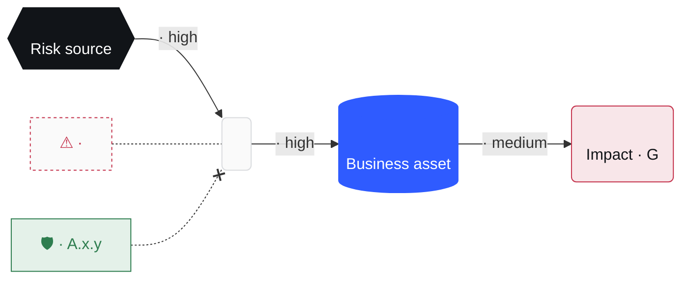

Turn a worry ("what if our payroll supplier gets ransomware?") into one scored, owned, treated risk in `grc/risk-register.md`. The risk is a **scenario** with a drawn **path**, scored twice: **inherent** (today's controls) and **residual** (after treatment). The user decides through `grc-grill`; you look up the rest.

## Steps

1. **Frame.** Write the risk as one **scenario**: `<risk source> could <feared event: disclosed, altered, lost, unavailable> <asset> through <path>`. Read `grc/risk-register.md`: when the same scenario is there, this run is a **reassessment** of that row. Then show the first **attack path** (see Draw: nodes, edges and the weaknesses the docs show, no controls yet) before any question, so the user corrects the path itself. Done when the user has seen the scenario and its attack path, and you know whether it's new.

2. **Grill.** Call the Skill tool with `grc-grill`:
   - intensity: `hard`
   - destination: scenario, its path (entry point and steps), asset and its business value, existing controls, likelihood, severity, treatment (reduce, accept, transfer, avoid), risk owner, due date
   - docs: `grc/context.md`, `grc/risk-register.md`, `grc/policies/`, the latest audit in `grc/evidence/`
   - framework: the frameworks in scope; scoring by ISO 27005 and EBIOS RM
   - output default: `html`

   Done when it hands back every field and the formats.

3. **Score.** Use the scales in `grc/context.md`, else these:
   - **Severity** G1 minor · G2 significant (recoverable) · G3 serious (hard to recover) · G4 critical (irreversible, or threatens the organisation).
   - **Likelihood** V1 unlikely · V2 possible · V3 likely · V4 near certain.
   - **Level** high when G3+ with V3+, or G4 with V2+; low when both are 2 or less; medium otherwise.

   Score inherent, then residual with the treatment's controls in place. When residual is above the appetite in `grc/context.md` and the treatment is `accept`, the owner's acceptance must be in the trace as a `user` row, else ask for it. Done when both scores are set and the residual is within appetite or accepted.

4. **Map.** For each control in the treatment, give its ISO 27001:2022 Annex A control, then the NIS2, DORA and GDPR articles it serves when that framework is in scope. Done when every control has its ISO 27001 reference.

5. **Draw.** Decide the **attack path**, then draw it. Write every word for a manager, not an engineer: **plain words** ("fake login page", not "AiTM kit"; "admin's work account", not "Entra ID identity"); product names and jargon stay in the report.
   - **nodes**, in order, 4 to 7: the risk source (`role: source`), each hop the attacker takes (a lure, an identity, a credential, a system), the business asset (`role: asset`), the feared event with its severity (`role: impact`). Each has an `icon` (`attacker user mail phone key web computer server cloud database container vendor payment lock bug alert`), a 1 to 3 word `label` and a `type`.
   - **edges**, one between each pair of nodes: what the attacker does, in 2 to 4 words (`captures password + SMS`), its `severity`, and the `control` that breaks it when there is one (`name`, ISO 27001 `ref`, `status`: `in place` or `planned`). A control goes on the one hop it actually stops: separate admin accounts do not stop a click on a link. A control that stops no hop stays in the treatment table only.
   - **findings**: each weakness that makes a hop possible, on its node (`kind`: Weak spot, Missing control, Known flaw, Incident; `source`: the doc or audit that shows it). At most 3 per node, titles of 6 words or fewer; merge the rest. Context such as an ongoing phishing wave goes in the scenario, not on a node.
   - The header: id, title, scenario, inherent and residual score once scored.

   **Look** ([theme.md](theme.md)): soft gray background, flat and square, a small circle with a play ▶ icon (no text) where the path starts, then the nodes left to right in rows, each joined to the next by a thin black arrow labelled with what the attacker does; the risk source black, the asset electric blue, the impact and each weak spot dashed red, the hops gray; each control a green box on the hop it breaks (solid in place, dashed planned), with its ISO 27001 reference.

   Show it in the conversation first:
   1. **visualize.** Search your tools, deferred ones included, for `visualize` (or a widget, Artifact or canvas tool). When one exists, load it, read its read-me, and draw the attack path with it inline, in the look above and [theme.md](theme.md), not the tool's default palette. This is the default whenever such a tool exists.
   2. No such tool, on a local machine: open the saved copy in the default browser (`open` on macOS, `xdg-open` on Linux, `start` on Windows) and say so in one line with the path.
   3. No such tool, on a remote shell with a headless browser: screenshot the saved copy to `grc/risks/<id>-attack-path.png` and link it.
   4. None of these: print the ASCII template and say where the saved copy is.

   Always also save a copy: `attack-path.html` from this skill's folder, filled into `grc/risks/<id>-attack-path.html` (only its JSON; the page draws itself in the same look).

   Never paste Mermaid or HTML source into the reply: a chat shows it as code, not a picture. Never fall back to 2 to 4 when a visualize tool exists. Redraw it after the grill with the controls and scores. Put the Mermaid version in the report file only. Done when the user has seen the final attack path.

6. **Write.** Add or update the row in `grc/risk-register.md` (create it from the template when missing; ids `R-001`, `R-002`…). Write the assessment as `grc/risks/<id>-<slug>.md` from the report template, then render each format the user picked:
   - `md`, `html`, `csv`, `json`: write them yourself next to the report; `html` renders the Mermaid with `mermaid@11.4.1` from jsdelivr. Every visual asset (html, pdf, pptx, xlsx, docx, images, the inline drawing) follows [theme.md](theme.md): one blue accent, grays, Geist, flat, light only. Text-only files (md, json, csv, yaml, Jira) stay plain.
   - `pdf`, `pptx`, `xlsx`: call the Skill tool with `pdf`, `pptx` or `xlsx`, with the report and [theme.md](theme.md) as the source; the path goes in as an image (`mmdc` when installed, else drawn with the target's own shapes).
   - Jira: create one issue (title: the scenario, owner, due date, link to the report) through the Jira connector; without one, say so and hand over the CSV row.

   Done when the register row exists and every requested file or issue is listed with its path or link.

## Templates

<register-template>
# Risk register

| ID | Scenario | Asset | Owner | Inherent | Treatment | Controls (ISO 27001) | Residual | Status | Due | Updated | Trace |
|---|---|---|---|---|---|---|---|---|---|---|---|
| R-001 | <scenario> | <asset> | <owner> | G3·V3 high | reduce | A.5.19, A.8.13 | G3·V1 medium | open | <date> | <date> | traces/<file> |
</register-template>

<path-template>

</path-template>

<ascii-template>
```
┌────────────────┐   ┌────────────────┐   ┌────────────────┐   ┌────────────────┐
│ SMS-only MFA   │──▶│ Code phished ↑ │──▶│ Admin hijacked │──▶│ Payments ↓     │
│ AWS admins     │   │ fake login     │   │ full cloud     │   │ prod down · G4 │
└────────────────┘   └───────┬────────┘   └───────┬────────┘   └────────────────┘
                        🛡 FIDO2 · A.8.5     🛡 review · A.8.2
```
</ascii-template>

<report-template>
# <ID> · <scenario>

**Owner** <owner> · **Status** <open | treated | accepted | closed> · **Due** <date>

## Scenario
Risk source, feared event, asset and business value.

## Attack path
Visual: `<id>-attack-path.html`

<path-template>

## Score
| | Severity | Likelihood | Level |
|---|---|---|---|
| Inherent | | | |
| Residual | | | |

<grid: G4 to G1 rows × V1 to V4 columns, `●` inherent, `○` residual, `→` the move>

## Treatment
<reduce | accept | transfer | avoid>, and why.

| Control | ISO 27001 | NIS2 | DORA | GDPR |
|---|---|---|---|---|

## Decisions
Link to the trace, and the calls made without the user.
</report-template>
