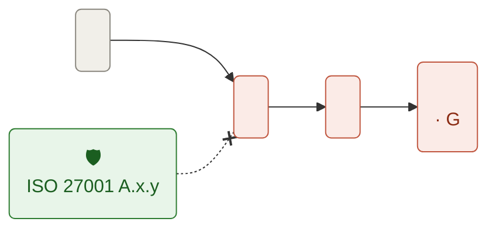

Turn a worry ("what if our payroll supplier gets ransomware?") into one scored, owned, treated risk in `grc/risk-register.md`. The risk is a **scenario** with a drawn **path**, scored twice: **inherent** (today's controls) and **residual** (after treatment). The user decides through `grc-grill`; you look up the rest.

## Steps

1. **Frame.** Write the risk as one **scenario**: `<risk source> could <feared event: disclosed, altered, lost, unavailable> <asset> through <path>`. Read `grc/risk-register.md`: when the same scenario is there, this run is a **reassessment** of that row. Then show the first **chain** (see Draw, no controls yet) before any question, so the user corrects the path itself. Done when the user has seen the scenario and its chain, and you know whether it's new.

2. **Grill.** Call the Skill tool with `grc-grill`:
   - intensity: `hard`
   - destination: scenario, its path (entry point and steps), asset and its business value, existing controls, likelihood, severity, treatment (reduce, accept, transfer, avoid), risk owner, due date
   - docs: `grc/context.md`, `grc/risk-register.md`, `grc/policies/`, the latest audit in `grc/evidence/`
   - framework: the frameworks in scope; scoring by ISO 27005 and EBIOS RM
   - output default: `html`

   Done when it hands back every field and the formats.

3. **Score.** Use the scales in `grc/context.md`, else these:
   - **Severity** G1 minor · G2 significant (recoverable) · G3 serious (hard to recover) · G4 critical (irreversible, or threatens the organisation).
   - **Likelihood** V1 unlikely · V2 possible · V3 likely · V4 near certain.
   - **Level** high when G3+ with V3+, or G4 with V2+; low when both are 2 or less; medium otherwise.

   Score inherent, then residual with the treatment's controls in place. When residual is above the appetite in `grc/context.md` and the treatment is `accept`, the owner's acceptance must be in the trace as a `user` row, else ask for it. Done when both scores are set and the residual is within appetite or accepted.

4. **Map.** For each control in the treatment, give its ISO 27001:2022 Annex A control, then the NIS2, DORA and GDPR articles it serves when that framework is in scope. Done when every control has its ISO 27001 reference.

5. **Draw.** Draw the **path** as a **chain**: 3 to 5 rounded boxes left to right joined by arrows, each a bold title of 2 or 3 words with an arrow when it moves (`Cost ↑`, `Payments ↓`) and one short grey line under it. The first box is the cause, neutral; every box after it is a consequence, tinted red; the last is the feared event with its severity. The control that breaks the chain goes under the box it blocks, as a green box with its ISO 27001 reference. Then show it the best way the harness allows:
   Always fill `chain.html` from this skill's folder (plus the inherent to residual move on the grid once scored) into `grc/risks/<id>-chain.html`, then show it with the first of these that works:
   1. A tool that renders a page or an image in the conversation (an Artifact, visualize or preview tool): render it there.
   2. A local machine: open the file in the browser (`open` on macOS, `xdg-open` on Linux, `start` on Windows) and link its path.
   3. A remote shell with a headless browser: screenshot it to `grc/risks/<id>-chain.png` and link the image.
   4. Nothing above works: print the ASCII template, and say the visual is in the HTML file.

   Never stop at ASCII when one of 1 to 3 works.

   Redraw it after the grill with the controls in place. Always put the Mermaid version in the report. Done when the user has seen the final chain.

6. **Write.** Add or update the row in `grc/risk-register.md` (create it from the template when missing; ids `R-001`, `R-002`…). Write the assessment as `grc/risks/<id>-<slug>.md` from the report template, then render each format the user picked:
   - `md`, `html`, `csv`, `json`: write them yourself next to the report; `html` renders the Mermaid with `mermaid@11.4.1` from jsdelivr.
   - `pdf`, `pptx`, `xlsx`: call the Skill tool with `pdf`, `pptx` or `xlsx`, with the report as the source; the path goes in as an image (`mmdc` when installed, else drawn with the target's own shapes).
   - Jira: create one issue (title: the scenario, owner, due date, link to the report) through the Jira connector; without one, say so and hand over the CSV row.

   Done when the register row exists and every requested file or issue is listed with its path or link.

## Templates

<register-template>
# Risk register

| ID | Scenario | Asset | Owner | Inherent | Treatment | Controls (ISO 27001) | Residual | Status | Due | Updated | Trace |
|---|---|---|---|---|---|---|---|---|---|---|---|
| R-001 | <scenario> | <asset> | <owner> | G3·V3 high | reduce | A.5.19, A.8.13 | G3·V1 medium | open | <date> | <date> | traces/<file> |
</register-template>

<path-template>

</path-template>

<ascii-template>
```
┌────────────────┐   ┌────────────────┐   ┌────────────────┐   ┌────────────────┐
│ SMS-only MFA   │──▶│ Code phished ↑ │──▶│ Admin hijacked │──▶│ Payments ↓     │
│ AWS admins     │   │ fake login     │   │ full cloud     │   │ prod down · G4 │
└────────────────┘   └───────┬────────┘   └───────┬────────┘   └────────────────┘
                        🛡 FIDO2 · A.8.5     🛡 review · A.8.2
```
</ascii-template>

<report-template>
# <ID> · <scenario>

**Owner** <owner> · **Status** <open | treated | accepted | closed> · **Due** <date>

## Scenario
Risk source, feared event, asset and business value.

## Path
<path-template>

## Score
| | Severity | Likelihood | Level |
|---|---|---|---|
| Inherent | | | |
| Residual | | | |

<grid: G4 to G1 rows × V1 to V4 columns, `●` inherent, `○` residual, `→` the move>

## Treatment
<reduce | accept | transfer | avoid>, and why.

| Control | ISO 27001 | NIS2 | DORA | GDPR |
|---|---|---|---|---|

## Decisions
Link to the trace, and the calls made without the user.
</report-template>
