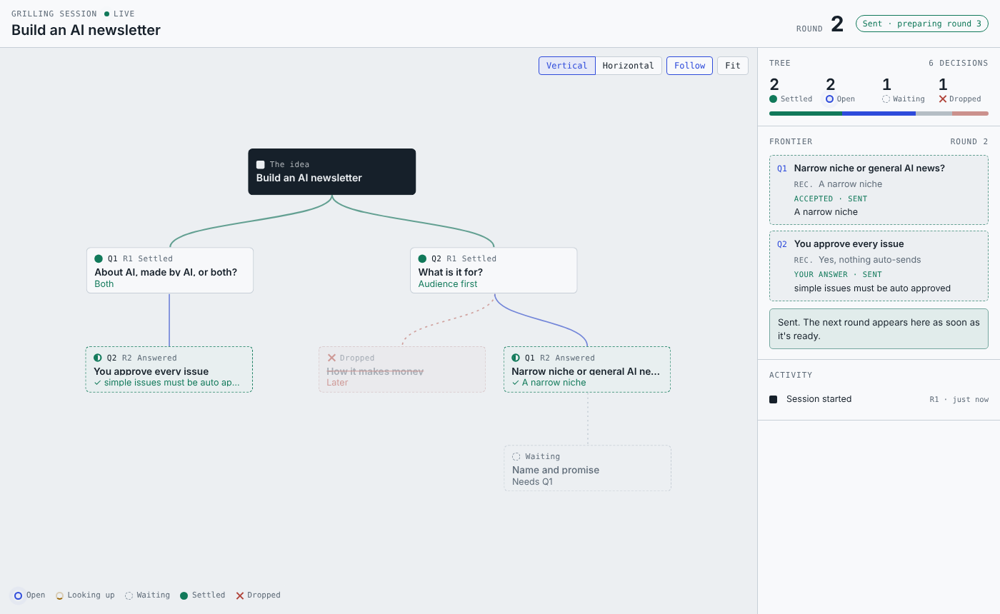

# grill-me-live

Get grilled on an idea while the decision tree grows live in your browser.

The interview is [Matt Pocock's grilling](https://github.com/mattpocock/skills/tree/main/skills/productivity/grilling): rounds of questions, each with a recommended answer, until a loose idea becomes a set of decisions. This skill draws it as a tree that updates as you go. Answer a question and it turns green; drop it and everything that depended on it fades out. Answer in chat or on the page.



## How it works

```
you ── chat ──▶ agent ── writes ──▶ .grill/state.json
                  ▲                        │
                  │                 grill.mjs serve  (localhost:4747)
          grill.mjs wait                   │ pushes every change
                  │                        ▼
         .grill/answers.json ◀── Send ── browser page
```

- The agent keeps the tree in `.grill/state.json` and rewrites it every round.
- `scripts/grill.mjs serve` (Node 18+, no dependencies) shows the page and pushes each change to it.
- On the page: **Accept** the recommendation, **Answer** in your own words, or **Drop** the question, then **Send answers**.
- The agent waits on `grill.mjs wait`, which returns your answers as soon as you press Send. You don't type "next".
- `.grill/` stays in your project as the record of every decision, with each round's answers in `.grill/history/`.
- **Receipt**: at the end (or any time, from the page's Receipt link) you get a receipt of the session: every decision settled or dropped, why, and whether you took the recommendation or answered in your own words.
- **Deck**: `grill.mjs deck` (or the page's Deck link) turns the session into slides for the people who were not in the room: title, the whole tree, one slide per top-level decision with its settled answers and where each came from, the dropped decisions, and next steps. One offline HTML file; arrow keys move, Print gives one page per slide.
- The page follows your system's light or dark setting. The button at the top right switches between **System**, **Light** and **Dark**, and the browser remembers your choice.

## Install

Copy this folder into your agent's skills folder. For Claude Code, that's `~/.claude/skills/grill-me-live/` for all projects or `.claude/skills/grill-me-live/` for one. Other agents (Codex, Cursor, Copilot, Gemini) work too: the skill only needs the agent to run `node` and write files.

## Use

```
/grill-me-live I want to start an AI newsletter
```

The agent starts the server and gives you a link, usually `http://localhost:4747`. Keep the page open next to the chat. At the end it can write a **snapshot**: one self-contained HTML file of the whole tree to share.

```
node scripts/grill.mjs serve --open   # start the page
node scripts/grill.mjs wait           # wait for Send, print the answers
node scripts/grill.mjs answers        # print answers saved so far
node scripts/grill.mjs snapshot       # write a shareable HTML file
node scripts/grill.mjs receipt        # write the session receipt (.grill/receipt.html + .md)
node scripts/grill.mjs deck           # write the session as slides (.grill/deck.html)
node scripts/grill.mjs stop
```

## Limits

- **Same machine only.** The page is on `localhost`, so the agent has to run where your browser is. In cloud sessions the agent grills you in chat and can hand you a snapshot at the end.
- **Local requests only.** The server listens on `127.0.0.1`, accepts requests addressed to `localhost` only, and refuses writes from other websites.
- **One session per folder.** The tree lives in `./.grill`.
- **Waiting depends on the agent.** Claude Code waits in the background, so you can still type in chat. Other agents may block on `wait` for up to 9 minutes at a time, then wait again.

## Test

```
node skills/grill-me-live/test/smoke.mjs
```

Covers the page, live updates, the request guards, answering, Send and `wait`, snapshots, the receipt and the deck.

## Evals

`evals/` holds a [`claude plugin eval`](https://code.claude.com/docs/en/plugin-evals) suite that checks how an agent follows the skill:

| Case | What it checks |
|---|---|
| `first-round` | Starts the server, writes a valid `.grill/state.json`, waits for Send in the background, posts round 1 with Q numbers matching the tree and questions a "yes" can accept |
| `answers-from-page` | Reads answers sent from the page, archives them, settles accepts and pushback, drops with a reason, never deletes a node, and builds round 2 on the answers |
| `remote-session` | When the browser can't reach `localhost`, grills in chat without starting the server, still records the tree, and offers a snapshot |

```
skills/grill-me-live/evals/run.sh            # all cases, 3 runs each
skills/grill-me-live/evals/run.sh --runs 1 --case first-round
```

`run.sh` wraps the skill in a throwaway plugin (this repo isn't one) and runs the suite with a Sonnet judge. The cases grant Bash, so the runner needs Claude Code's OS sandbox: run it as a normal user, and on Linux install `bubblewrap` and `socat`. Results go to `evals/results/` (git-ignored).

In a headless run, the background `wait` keeps the session open until the case's `timeout_seconds`, because nobody presses Send. The round has been posted and the tree written by then, which is what the graders check.
